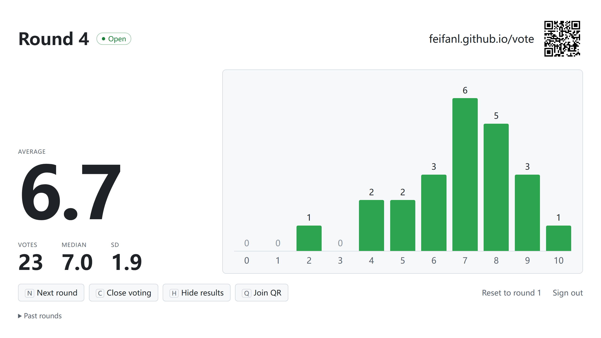
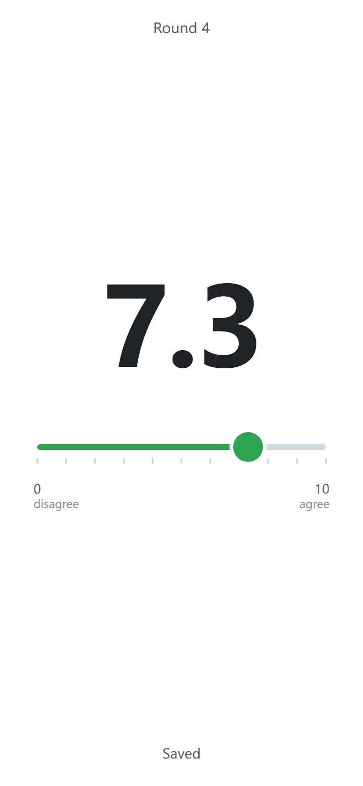

# Vote

Very minimalist live poll for talks / presentations.

Show a claim on your own set of slides; the audience then opens a URL on their phones and rates their agreement on a slider from 0 to 10.

You can then view and show the average score and distribution of ratings.

- **Audience page** (`index.html?s=CODE`): one slider, 0–10 in 0.1 steps. **No login**, saves immediately. Without a code it asks for one.
- **Host page** (`host.html`): average, n, median, SD, histogram, join QR code. Anyone can host by signing in with Google; each account gets its own poll and a 5-character join code.

<picture>
  <source media="(prefers-color-scheme: dark)" srcset="docs/host-dark.png" />
  
</picture>

<p align="center">
  <picture>
    <source media="(prefers-color-scheme: dark)" srcset="docs/audience-dark.png" />
    
  </picture>
</p>

It's plain HTML, CSS, and JS with no build step. Any static host works; the steps below use GitHub Pages. Shared state lives in Firebase (Cloud Firestore + Auth).

## What you need

- A GitHub account (or any other static host)
- A Google account for Firebase
- Python 3, only for testing locally

## Setup

Throughout, replace `<user>` with your GitHub username and `<repo>` with the repo name you choose (for example `vote`).

### 1. Get the code

Fork this repo, or copy its files into a new repo. The repo name becomes the URL path: a repo named `vote` is served at `https://<user>.github.io/vote/`.

> **`config.js` contains the original author's Firebase project.** Replace it with your own (step 2). Otherwise your copy sends votes to someone else's database.

### 2. Create the Firebase project

1. In the [Firebase console](https://console.firebase.google.com/), create a project. The free Spark plan is enough; Google Analytics is not needed.
2. **Build → Authentication → Get started**. Under **Sign-in method**, enable **Anonymous** and **Google**.
3. Authentication → **Settings → Authorized domains**: add `<user>.github.io` (or your own domain). `localhost` is already listed.
4. **Build → Firestore Database → Create database**. Pick a location near your audience and start in **production mode**.
5. **Project settings → General → Your apps**: add a **Web** app (no Hosting needed). Replace the `firebaseConfig` values in `config.js` with yours.

These config values are public by design: every visitor's browser receives them. Access control comes entirely from the security rules in step 3.

### 3. Publish the rules and try it

1. In the Firebase console, go to **Firestore Database → Rules**, replace the contents with `firestore.rules`, and click **Publish**.
2. Serve the folder locally from the repo root:

   ```bash
   python -m http.server 8000
   ```

3. Open http://localhost:8000/host.html and sign in with Google. On first sign-in it creates your session with a random join code, `{ host: <your uid>, round: 1, open: true }`. Signing in again later, from any browser, reopens the same session.

To test voting, open the join URL shown on the host page (http://localhost:8000/?s=CODE) in another browser or a phone on the same network. Each browser counts as one voter.

### 4. Deploy

Commit `config.js` with your values and push. Then, on GitHub: **Settings → Pages → Build and deployment → Deploy from a branch**, branch `main`, folder `/ (root)`.

- Audience: `https://<user>.github.io/<repo>/?s=CODE` (or the bare URL, which asks for the code)
- Host: `https://<user>.github.io/<repo>/host.html`, for anyone with a Google account

The join URL and QR code on the host page come from wherever the page is served, so nothing else needs changing. If you name the repo `<user>.github.io`, the site is served at the domain root instead.

## Running a session

| Key | Effect |
|---|---|
| `N` | Next round: empty round, voting open, every phone resets |
| `C` | Close or reopen voting |
| `H` | Hide or show results (only on this screen; n stays visible) |
| `Q` | Full-screen join QR (`Esc` or click to close) |

Results start hidden each round, so a projected running average doesn't anchor people who haven't voted yet. A typical flow per claim:

1. Show the claim on your slide and press `N`.
2. Wait for n to settle, then press `C` to close voting.
3. Press `H` to reveal the results.

Clicking **Next round** asks for confirmation if the round has votes; the `N` key doesn't, to keep things fast during a talk. Earlier rounds are listed under **Past rounds** at the bottom of the host page.

**Reset to round 1** (footer, no shortcut) starts over for a new talk. It permanently deletes the votes from every round, after a confirmation.

## How it works

```
sessions/{code}                            { host, round, open, updated }
sessions/{code}/rounds/{round}/votes/{uid} { value: 0–10, ts }
```

- Each host's session is keyed by its join code: 5 characters from `23456789ABCDEFGHJKMNPQRSTUVWXYZ` (no 0/O or 1/I/L). The host page finds the session whose `host` is the signed-in uid, or creates one with a fresh code.
- Each phone signs in anonymously and writes one document per round, keyed by its uid. Changing a vote overwrites it.
- Next round only increments `round`. Nothing is deleted, so every past round stays in Firestore until you reset.
- Reset closes voting, deletes every vote in rounds 1 through the current one, then sets `round` back to 1 with voting open.
- The rules only let a voter write their own vote, only to the current round, only while voting is open, and only a number from 0 to 10 (the slider moves in 0.1 steps; the histogram rounds each vote to the nearest whole number). Only a session's host can change that session or read other people's votes in it. Creating a session requires a Google sign-in, and the creator must be its `host`.

## Limits

- **Duplicate votes:** an anonymous identity is per browser, so someone using several browsers or private windows can vote more than once.
- **Free quota:** Spark allows 20,000 Firestore writes and 50,000 reads per day. Each vote or change is one write, and the host page reads each vote as it arrives. A room of a few hundred people over a dozen claims stays well inside that.
- **Connections:** Firestore has no simultaneous-connection cap on Spark, which is why this uses Firestore rather than the Realtime Database (capped at 100).

## Customizing

- **Labels:** the `disagree` / `agree` words are in `index.html`.
- **Colors:** all colors are CSS variables at the top of `app.css`, with a light and a dark set. The page follows the device's theme.
- **Firebase SDK version:** pinned in the import URLs in `firebase.js`.

## Troubleshooting

| Symptom | Fix |
|---|---|
| Pages say `Not configured` | `config.js` has placeholder values (step 2.5). |
| Sign-in fails with `auth/unauthorized-domain` | Add the site's domain under Authentication → Settings → Authorized domains. |
| Phones show `Couldn't connect` | Anonymous sign-in isn't enabled (step 2.2). |
| Host page shows `Couldn't start a session` with `permission-denied` | The rules in the console don't match `firestore.rules`, or Google sign-in isn't enabled (step 2.2). |
| Phones show `No poll with code …` | The code was mistyped; it's the `?s=` part of the join URL on the host page. |
| Phones say `Couldn't save` while voting is open | Same as above: the rules in the console don't match `firestore.rules`. |

## Files

| File | Purpose |
|---|---|
| `index.html`, `voter.js` | Audience page |
| `host.html`, `host.js` | Host page |
| `app.css` | Shared styles |
| `firebase.js` | Firebase init and SDK imports |
| `config.js` | Your Firebase config |
| `firestore.rules` | Security rules to paste into the Firebase console (not loaded by the site) |
